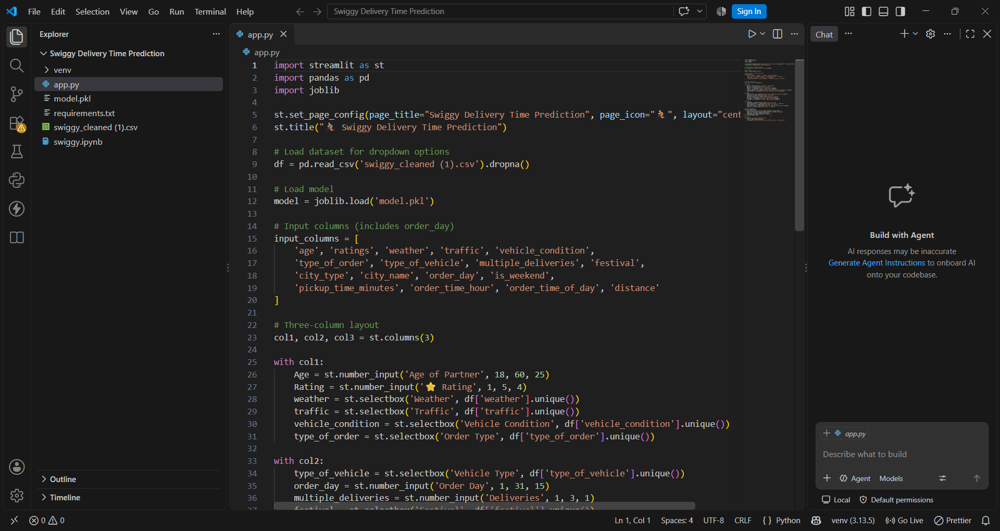
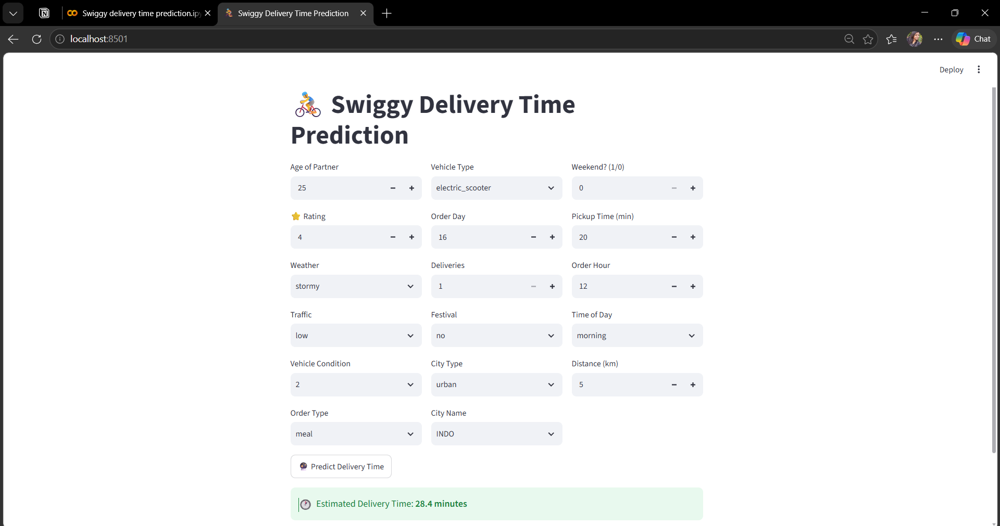

# 🍔 Swiggy Delivery Time Prediction

A Machine Learning web application that predicts **food delivery time** based on order and delivery-related information.

## 🚀 Features

- 📊 Machine Learning-based delivery time prediction
- 🍔 Predicts estimated food delivery time
- 🖥️ Interactive Streamlit web interface
- ⚡ Fast and simple predictions
- 📱 User-friendly interface
- ☁️ Ready for deployment

## 🛠️ Tech Stack

- **Python**
- **Pandas**
- **Scikit-learn**
- **Streamlit**
- **Pickle**

## 📂 Project Structure

```text
Swiggy/
│
├── app.py
├── model.pkl
├── requirements.txt
├── README.md
│
├── assets/
│   ├── screenshot.png
│   ├── prediction.png
│   └── demo.gif
│
└── [dataset / other files]
```

## ⚙️ Run Locally

### 1. Clone the Repository

```bash
git clone https://github.com/kotturuDivya04/swiggy-delivery-time-prediction.git
cd swiggy-delivery-time-prediction
```

### 2. Create a Virtual Environment

```bash
python -m venv venv
```

### 3. Activate the Virtual Environment

**Windows:**

```bash
venv\Scripts\activate
```

### 4. Install Dependencies

```bash
pip install -r requirements.txt
```

### 5. Run the Application

```bash
streamlit run app.py
```

The application will open in your browser at:

```text
http://localhost:8501
```

## 🌐 Live Demo

👉 **[Open the Deployed Application](YOUR_STREAMLIT_APP_URL)**

## 📸 Screenshots

### Application Interface



### Prediction Result



## 🎥 Demo


[▶️ Watch the Full Demo Video](YOUR_GITHUB_ISSUE_VIDEO_URL)

## 📌 Project Highlights

This project demonstrates the complete workflow of a Machine Learning application:

**Data → Preprocessing → Model → Prediction → Streamlit Web Application**

## 👩‍💻 Author

### Divya Kotturu

B.Tech Computer Science (Data Science)

Built with **Python, Machine Learning & Streamlit**.
